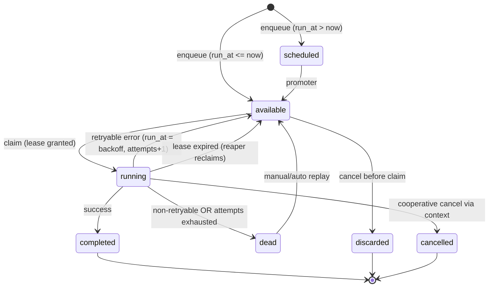

# Beanline: A Job Queue and Background Worker System

> *Queues without the wait.*

| | |
|---|---|
| Status | Design draft v1.0 (reviewed) |
| Author | Engineering |
| Date | 2026-10-17 |
| Language | Zig (0.14.x or newer, std-only where practical) |
| Name | Beanline |
| Tagline | Queues without the wait. |
| License | MIT, no paid tiers, all features in the open |

---

## 1. Executive summary

Beanline is a production-grade job queue and background worker system written in Zig.
It provides:

- A dual-backend broker: PostgreSQL or Redis, behind one identical semantic contract.
- Reliable execution: leases, heartbeats, fencing tokens, retries with configurable
  backoff and jitter, dead letter queues, cancellation, and graceful shutdown.
- A cron scheduler with timezone awareness, DST-correct firing, misfire policies,
  leader election, and idempotent run deduplication.
- A self-contained web dashboard (REST + live SSE) with authentication, queue
  controls, replay, and audit history, embedded in the same static binary.
- An embeddable library API for in-process workers and a standalone daemon mode
  for sidecar/dedicated deployments.

The pitch in one sentence: **the reliability semantics of River (Postgres-native,
transactional enqueue), the throughput of Asynq/BullMQ (Redis backend), the
operational simplicity of Sidekiq, and every feature Sidekiq Pro charges for
(uniqueness, batches, rate limiting, dashboard, dead scheduling) shipped free in
one small static binary with no garbage collector and no runtime dependencies
beyond the database you already run.**

Why Zig is the right tool for this:

- No GC and no runtime pauses: tail latency (p99/p999) end-to-end job completion
  is predictable, which is exactly what queue consumers need (Ruby, Node, Go, and
  Java equivalents all have measurable GC pause distributions).
- One static binary per OS/arch: trivial deployment, fast startup (<100 ms),
  small footprint (<50 MB RSS baseline per worker process).
- Comptime type safety: job argument schemas are Zig structs; payloads are
  validated at deserialization against a known type, and retry classes are
  derived from declared error sets instead of runtime string matching.
- Structured concurrency: `spawn` + explicit supervisor tree make "no orphaned
  task, no leaked job" a compile-time discipline rather than a convention.

---

## 2. Goals and non-goals

### Goals

1. Correctness under failure: at-least-once execution by default, effectively-once
   when combined with fencing tokens and idempotent handlers, zero lost jobs under
   worker crash, kill -9, DB failover, or clock skew.
2. Identical semantics on both backends, enforced by a shared contract test suite.
   Switching Postgres to Redis changes throughput and durability trade-offs, not
   behavior.
3. Transactional enqueue: in Postgres mode, `enqueue()` can join the caller's
   open database transaction (transactional outbox), so "the row changed and the
   job exists" is atomic. This eliminates the dual-write bug class.
4. Ops-friendly: single binary, embedded dashboard, Prometheus metrics, OTel
   traces, structured logs, sane defaults, one env var to configure.
5. Fair, bounded resource use: per-queue concurrency caps, global rate limits,
   priority with starvation protection, backpressure when queues fall behind.
6. Small, auditable dependency surface: vendor a Postgres driver (pg.zig), roll a
   minimal RESP client in-house, serve the dashboard with httpz. No C libraries on
   the hot path.

### Non-goals

- Not a distributed compute framework (no map/reduce, no sharding of one job
  across machines).
- Not a streaming system: no Kafka-style replay, ordering across partitions, or
  sub-millisecond delivery guarantees. Second-scale or better is the contract.
- Not multi-region or geo-distributed by design. Active/passive via the database
  is supported; active/active across regions is explicitly out of scope for 1.0.
- Not a general-purpose scheduler for arbitrary cluster placement (this is not
  Kubernetes CronJob or Nomad; it is an application-level job runner).

---

## 3. Competitive analysis

### Landscape

| Capability | Sidekiq (Ruby) | BullMQ (Node) | Asynq (Go) | River (Go) | Celery (Python) | **Beanline** |
|---|---|---|---|---|---|---|
| Backend | Redis | Redis | Redis | Postgres | AMQP/Redis/DB | **Postgres or Redis** |
| Transactional enqueue | No | No | No | Yes | No | **Yes (PG mode)** |
| Unique jobs | Pro (paid) | Partial | Partial | Yes | DIY | **Yes (free)** |
| Batches / workflows | Pro (paid) | Flows | Partial | Partial | Canvas | **Yes (free)** |
| Rate limiting | Pro (paid) | DIY | Yes | DIY | Yes | **Yes (free)** |
| Web UI / dashboard | Pro (paid) | bull-board (separate app) | DIY | DIY | Flower (separate) | **Embedded, auth included** |
| Dead letter + replay | Basic | Basic | Basic | Yes | DIY | **Yes + event audit** |
| Cron | Need side tool (CRONIT) | Repeatable jobs | Yes | Yes | Beat | **Yes, DST-correct, jittered** |
| Deploy artifact | Gem + Rails app | npm + Node | Binary | Library in binary | Python stack | **Single static binary, embed or daemon** |
| GC pauses | Yes (Ruby) | Yes (V8) | Yes (Go) | Yes (Go) | Yes (CPython) | **None** |
| Crash isolation of bad jobs | No | No | No | No | No | **Optional subprocess sandbox** |

### Where Beanline genuinely wins

1. **Backend choice is a policy, not a rewrite.** No mainstream tool offers both
   Postgres and Redis with one tested contract. Postgres mode buys consistency
   (outbox, no dual-write), zero extra infra, backups you already run. Redis mode
   buys raw throughput and offloads the primary DB. Teams start with Postgres and
   graduate hot queues to Redis without touching job code.
2. **Pro features for free.** Sidekiq's uniqueness, batches, rate limiting, and
   the dashboard are $876+/yr per process. They are table stakes here.
3. **Predictable tails.** GC-free execution plus a bounded thread-per-queue model
   gives tight p99 end-to-end latency; queue systems are precisely where "average
   is fine, tail is user pain" hurts most.
4. **Crash isolation (sandbox mode).** A segfaulting or runaway handler (C interop,
   exotic parsers, untrusted modules) kills only its subprocess; the supervisor
   requeues the job with reason `worker_crash`. No equivalent in the field.
5. **Zero-build dashboard.** bull-board is a separate Express app with a Vue
   build chain. Beanline serves a no-build HTML+SSE UI from the worker binary.

### Honest trade-offs (why others still exist)

- Zig's ecosystem is young; expect to vendor or write a driver (pg.zig exists and
  is usable; the RESP client is small enough to own).
- Redis backend does not get transactional enqueue; cross-store atomicity (job +
  app row) is a Postgres-mode-only property. We state this in docs rather than
  fake it with sagas.
- Bootstrapping time: Sidekiq/BullMQ have decade-old middleware ecosystems. Beanline
  ships the ten middlewares everyone uses and makes the hook surface trivial.
- Postgres SKIP LOCKED throughput has real ceilings (roughly 5k-15k claims/s per
  DB depending on hardware and batch size). That is enough for the vast majority
  of applications; above it, users want Redis mode or should evaluate Kafka-class
  tooling, which is a different product.

---

## 4. System overview

```mermaid
flowchart LR
  subgraph Producer["Application process (embed mode or CLI/HTTP)"]
    API[Public API: enqueue, schedule, batch]
  end

  subgraph Broker["Broker backend (one of)"]
    PG[(PostgreSQL: jobs, events, leases, cron runs)]
    RD[(Redis: ready lists, delayed ZSET, lease keys, pubsub)]
  end

  subgraph Daemon["beanline daemon / worker process"]
    SUP[Supervisor]
    SCH[Cron scheduler\n(leader-elected)]
    WKV[Queue loop x N\n(claim, promote, reap)]
    POOL[Job executor pool\n(per-queue caps, fairness)]
    CTRL[Control server\n(HTTP: dashboard, REST, SSE, metrics)]
    HBT[Heartbeat / lease keeper]
  end

  API -->|enqueue / tx outbox| Broker
  WKV <-->|claim w/ lease, ack, retry| Broker
  SCH -->|idempotent inserts| Broker
  SUP --> SCH & WKV & POOL & CTRL & HBT
  POOL -->|perform| USERJOB[(Handler code)]
  BROWSER[Ops / developers] --> CTRL
  PROM[Prometheus] -.scrape.-> CTRL
  JAEGER[OTel collector] -.spans.-> CTRL
```

Process model: one `beanline` process runs the supervisor, any number of queue
loops, the executor pool, optionally the scheduler (leader-elected), and
optionally the dashboard server. All roles can be enabled per deployment via
config, so a small app embeds everything in one process and a large one splits
producers, workers, and dashboard tiers.

---

## 5. Core concepts and data model

### Concepts

| Term | Definition |
|---|---|
| Job | A typed unit of work: `kind` (handler name), JSON `args`, queue, priority, attempt policy. |
| Kind | Registered handler identity; args schema and error/retry policy attach to the kind. |
| Queue | Named FIFO/priority lane with its own concurrency cap and rate limit. |
| Lease | Time-bounded exclusive claim held by a worker, identified by `lease_epoch` (the fencing token). |
| Schedule | A cron expression that idempotently enqueues a job kind at wall-clock times. |
| Batch | A set of jobs with completion tracking and an optional callback job. |
| Event | An append-only record of everything that happened to a job (audit trail). |
| Dead | A job that exhausted retries or hit a non-retryable error; parked for replay or discard. |

### Job state machine



Rules:

- Transitions are only valid through the broker's claim/ack/retry primitives; the
  dashboard's actions (retry, discard, cancel) go through the same code path as
  library calls, never raw SQL.
- Every state write carries the `lease_epoch` predicate; a stale worker's write is
  a no-op, which makes double-ack and zombie-worker clobbering impossible by
  construction.
- `available` with `run_at > now()` is only reachable via a retry landing in the
  future; the promoter flips `scheduled -> available` in small batches.

### Event log

Every job keeps an append-only event trail: `enqueued`, `claimed(worker, epoch)`,
`attempt_failed(error, next_run_at)`, `retried_by_operator`, `cancelled`,
`dead(reason)`, `completed(duration)`. This powers the dashboard diff view,
post-mortems, and chaos-test assertions. It is a table in PG and a short TTL
stream/list per job in Redis (sampled by default; `events = full` opt-in).

---

## 6. PostgreSQL backend

Postgres mode is the default. It is a River-style design: the queue is a table,
claims use `SELECT ... FOR UPDATE SKIP LOCKED`, wakeups use `LISTEN/NOTIFY`.

### 6.1 Schema

```sql
CREATE TABLE beanline_jobs (
  id              BIGINT GENERATED ALWAYS AS IDENTITY PRIMARY KEY,
  queue           TEXT        NOT NULL,
  kind            TEXT        NOT NULL,
  args            JSONB       NOT NULL DEFAULT '{}',
  status          TEXT        NOT NULL DEFAULT 'available'
                  CHECK (status IN ('available','scheduled','running',
                                    'completed','dead','discarded','cancelled')),
  priority        SMALLINT    NOT NULL DEFAULT 1,   -- 0=critical .. 3=low
  run_at          TIMESTAMPTZ NOT NULL DEFAULT now(),
  max_attempts    INT         NOT NULL DEFAULT 25,
  attempts        INT         NOT NULL DEFAULT 0,
  lock_expires_at TIMESTAMPTZ,
  lease_epoch     BIGINT      NOT NULL DEFAULT 0,
  worker_id       TEXT,                             -- "<host>:<pid>:<bootid>"
  unique_key      TEXT,                             -- NULL = no uniqueness
  dedup_run_id    TEXT,                             -- (kind,dedup_run_id) for cron
  batch_id        BIGINT,
  tags            TEXT[]      NOT NULL DEFAULT '{}',
  context         JSONB       NOT NULL DEFAULT '{}',-- traceparent, metadata
  inserted_at     TIMESTAMPTZ NOT NULL DEFAULT now(),
  started_at      TIMESTAMPTZ,
  finished_at     TIMESTAMPTZ,

  CONSTRAINT beanline_jobs_cron_dedup UNIQUE NULLS NOT DISTINCT (kind, dedup_run_id),
  CONSTRAINT beanline_jobs_unique     UNIQUE NULLS NOT DISTINCT (queue, kind, unique_key)
      -- enforced via partial indexes instead when "skip/replace" semantics needed; see 11.2
);

CREATE INDEX beanline_jobs_claim
    ON beanline_jobs (queue, priority, run_at)
 WHERE status = 'available';

CREATE INDEX beanline_jobs_promote
    ON beanline_jobs (run_at)
 WHERE status = 'scheduled';

CREATE INDEX beanline_jobs_batch
    ON beanline_jobs (batch_id) WHERE batch_id IS NOT NULL;

CREATE TABLE beanline_job_events (
  job_id BIGINT NOT NULL REFERENCES beanline_jobs(id) ON DELETE CASCADE,
  seq    INT    NOT NULL,
  type   TEXT   NOT NULL,
  data   JSONB  NOT NULL DEFAULT '{}',
  at     TIMESTAMPTZ NOT NULL DEFAULT now(),
  PRIMARY KEY (job_id, seq)
);

CREATE TABLE beanline_workers (         -- presence + orphan reconciliation
  worker_id  TEXT PRIMARY KEY,
  boot_id    UUID NOT NULL,
  host       TEXT NOT NULL,
  pid        INT  NOT NULL,
  roles      TEXT[] NOT NULL,
  seen_at    TIMESTAMPTZ NOT NULL DEFAULT now()
);

CREATE TABLE beanline_schedules (       -- cron definitions (source of truth)
  id           TEXT PRIMARY KEY,     -- stable slug
  kind         TEXT NOT NULL,
  queue        TEXT NOT NULL DEFAULT 'default',
  cron         TEXT NOT NULL,        -- 5, 6, or descriptor form
  tz           TEXT NOT NULL DEFAULT 'UTC',
  args         JSONB NOT NULL DEFAULT '{}',
  misfire      TEXT NOT NULL DEFAULT 'skip',  -- skip | fireOnce | catchUp
  jitter_ms    INT NOT NULL DEFAULT 5000,
  enabled      BOOL NOT NULL DEFAULT true
);

CREATE TABLE beanline_batches (
  id BIGINT GENERATED ALWAYS AS IDENTITY PRIMARY KEY,
  total INT NOT NULL, remaining INT NOT NULL,
  callback_kind TEXT, callback_args JSONB,
  status TEXT NOT NULL DEFAULT 'open',   -- open | complete | cancelled
  inserted_at TIMESTAMPTZ NOT NULL DEFAULT now()
);
```

Notes:

- `UNIQUE NULLS NOT DISTINCT` requires PG 15+. On 13/14 the uniqueness and cron
  dedup constraints are expressed as partial unique indexes with
  `WHERE unique_key IS NOT NULL`, same semantics.
- The `beanline_jobs_claim` partial index is the hot one: `(queue, priority, run_at)`
  over `available` only, so claim scans are index-range reads, never table scans.
  Completed/dead rows do not bloat the claim path.
- Large deployments partition `beanline_jobs` by `inserted_at` monthly (pg_partman or
  hand-rolled) with retention enforced by dropping partitions; the claim index is
  global-per-partition and pruning is effective because `run_at` and `inserted_at`
  are close.

### 6.2 Claim algorithm (the core of correctness)

```sql
WITH batch AS (
  SELECT id
    FROM beanline_jobs
   WHERE queue = $1
     AND status = 'available'
     AND run_at <= now()
   ORDER BY priority, run_at
   FOR UPDATE SKIP LOCKED
   LIMIT $2
)
UPDATE beanline_jobs j
   SET status          = 'running',
       attempts        = j.attempts + 1,
       lease_epoch     = j.lease_epoch + 1,
       worker_id       = $3,
       started_at      = coalesce(j.started_at, now()),
       lock_expires_at = now() + $4::interval
  FROM batch
 WHERE j.id = batch.id
RETURNING j.*;   -- includes the fresh lease_epoch (fencing token)
```

- One round trip claims up to `$2` (configurable, default 4, adaptive: grow while
  the full batch is returned, shrink to 1 when claims come back empty).
- `SKIP LOCKED` means concurrent workers never contend or block each other; under
  heavy parallelism this degrades to near-zero lock waits.
- The returned `lease_epoch` is the fencing token. Heartbeat, ack, retry, and
  failure writes all use `WHERE id = $1 AND lease_epoch = $2 AND status = 'running'`,
  so a partitioned or stopped-over worker can never mark someone else's job.

### 6.3 Timeliness: NOTIFY + adaptive polling

- `enqueue` and state-promoting operations `NOTIFY beanline_job_insert (queue)`.
- Each queue loop keeps one `LISTEN` connection. On notify it claims immediately.
- A watchdog poll interval (default 10 s, adaptive 1 s..30 s) runs regardless, so
  a dropped notify (failover, restart) never loses timeliness, only adds latency.
  This belt-and-suspenders choice is deliberate: `LISTEN/NOTIFY` is fire-and-forget
  and does not survive connection loss with delivery guarantees.
- Delayed/cron jobs do not rely on notifications; the promoter loop claims
  `scheduled -> available` in the same batched, SKIP LOCKED style.

### 6.4 Lease, heartbeat, orphan reaping

- Lease default 60 s, minimum 15 s, per-kind override (long jobs set
  `lease = worst_case_duration + margin`).
- A single heartbeat task per worker batches extensions: one `UPDATE` per tick
  for all running jobs of that worker (`WHERE lease_epoch = ANY(...)` via join),
  at `lease/3` intervals. This keeps heartbeat cost flat, not per-job-per-second.
- The reaper (leader-elected, see 8.4) promotes any `running` job whose
  `lock_expires_at < now()` back to `available` (or `dead` if attempts
  exhausted), writing a `reaped` event. The reaped job gets a fresh epoch on next claim; any
  late writes from the zombie are fencing-rejected.
- A lease expiry is refunded: the attempt is given back, because a lease
  expiry is usually not the job's fault (worker killed, host rebooted, VM
  paused, heartbeat lost). The refund alone leaves a hole: a job whose handler
  kills its worker on every attempt never spends an attempt, so `max_attempts`
  never dead-letters it. `lease_losses` counts the expiries separately and is
  never refunded; once a job has lost `max_lease_losses` leases (default 3) it
  is dead-lettered. `max_lease_losses = 0` disables the bound.
- Boot reconciliation: on startup, a worker with a stable `worker_id` marks jobs
  where `worker_id = self AND lock_expires_at < now()` immediately rather than
  waiting for reaper cadence (fast crash-restart recovery).

### 6.5 Transactional outbox (headline feature of PG mode)

```zig
try app.db.run().transaction(&conn, struct {
    fn inner(tx: *sql.Tx) !void {
        try insertOrder(tx, order);              // application rows
        try beanline.enqueueIn(tx, .create_invoice, args, .{
            .queue = "billing",
            .unique_key = "order:" ++ order.id,
        });                                      // same tx, atomic with the rows
    }
}.inner);
```

The enqueue is an `INSERT` into `beanline_jobs` inside the caller's transaction.
Commit means both exist; rollback means neither. The `NOTIFY` fires on commit.
This is the dual-write fix that Redis-only queues fundamentally cannot offer.

### 6.6 Retention and size control

- `completed` jobs are deleted (or archived to `beanline_jobs_archive`) after
  `retention.completed = 72h`, in batched `DELETE ... LIMIT` loops to avoid long
  locks. Dead jobs are retained until operated (default 14 d warning, not auto).
- `beanline_job_events` follows its own shorter retention (default 7 d).
- A background size guard reports rows/index bytes to metrics and warns at
  `retention.max_pending` threshold (feeds backpressure, see 9.5).

---

## 7. Redis backend

Redis mode is for throughput-bound queues and for keeping job churn off the
primary Postgres. Design: no Streams consumer groups (rationale below); instead
priority lists plus a delayed ZSET plus per-job lease keys, with one Lua script
as the atomic claim primitive.

**Minimum version: Redis 5.0.** The scripts read the server clock with
`redis.call('TIME')` and then write. Before Redis 5.0 (effects replication) a
script that called a non-deterministic command and then a write command was
rejected outright, so Redis 3 and 4 fail every write path, not just some of
them. Beanline reads `INFO server` at connect time and refuses an older
server with a clear message, rather than letting every later operation fail
with an opaque one.

### 7.1 Key layout (all keys namespaced, cluster-safe by hash tag `{q}`)

```
beanline:{<queue>}:ready:<prio>          LIST    job payload JSON (LPUSH / LRANGE)
beanline:{<queue>}:delayed               ZSET    member=job id, score=run_at_ms
beanline:{<queue>}:job:<id>              HASH    status, attempts, epoch, meta
beanline:{<queue>}:lease:<id>            STRING  worker id, TTL = lease seconds
beanline:{<queue>}:expires:<id>          ZSET    score=lease_expiry_ms (reaper index)
beanline:{<queue>}:events:<id>           LIST    capped event trail (LTRIM)
beanline:sched:<id>:<run>                STRING  NX + TTL (cron idempotency)
beanline:{<queue>}:control               PUBSUB  cancel / pause / enqueue-now messages
```

### 7.2 Claim script (atomic, one RTT)

```lua
-- KEYS: ready:0..3, delayed, expires
-- ARGV: worker_id, lease_ms, batch_n, now_ms
-- 1) pop highest priority ready entries
-- 2) harvest due delayed members (ZRANGEBYSCORE delayed -inf now_ms LIMIT n)
-- 3) for each: write lease key (SET PX), add to expires ZSET, bump epoch
-- returns list of {job_id, payload, epoch}
```

The whole claim is one `EVALSHA` round trip: ready-list pop, delayed harvest,
lease write, and epoch bump in one atomic step. No race between "peek delayed"
and "it became claimable" because Lua is serialized per shard. Payloads are
written once at enqueue (HASH) so claim returns a reference, keeping lists small.

- Heartbeat = `PEXPIRE lease:<id> <ttl>` batched per tick (`MULTI`); the `expires`
  ZSET is refreshed to match.
- Ack = `HSET status completed` + `DEL lease` + `ZREM expires` + event push.
- Retry = same but `ZADD delayed` with the backoff score (retries always go
  through `delayed`, even immediate ones, so one mover owns promotion timing).

### 7.3 Promoter and reaper

- Promoter: `ZRANGEBYSCORE delayed -> ready` (Lua, batched, leader-elected).
  Redis has no eventing, so polling at ~50 ms on leaders; latency floor is
  ~`poll + RTT`, acceptable for a system whose Redis-mode target is
  high-throughput rather than lowest-latency. (BZPOPMIN was rejected: it binds a
  blocking client per queue/priority combination, breaks fair multi-queue
  scheduling, and cannot atomically harvest delayed too.)
- Reaper: pops expired members from `expires`, requeues their jobs (attempts
  already counted per claim semantics), same fencing checks as PG mode.

### 7.4 Why not Redis Streams consumer groups

They were evaluated and rejected for the primary queue: PEL-based redelivery
(`XAUTOCLAIM`) is O(pending) scan-ish, has no priority support, unfair reclaim
under mixed durations, and delayed jobs need a parallel ZSET anyway. Streams
remain fine for the optional audit fan-out. We document the rejection so future
maintainers do not relitigate it.

### 7.5 Backend contract

`Broker` is an interface (a Zig table of function pointers with uniform
signatures): `enqueue(tx?)`, `claim`, `heartbeat`, `finish`, `fail`, `cancel`,
`promote`, `reap`, `depth`. Postgres and Redis implement it. Because Redis keys
are queue-scoped while Postgres rows are global, the interface carries explicit
queue arguments: `heartbeat(queue, ids, epochs, lease)`,
`finish(queue, id, lease_epoch)`, `fail(queue, id, lease_epoch, ...)`,
`cancel(queue, id)`, and `promote/reap(queues, limit)`; the Postgres backend
accepts and ignores them. Beanline uses one shared contract test suite that both
backends run against; CI gates every commit on both backends (implemented in M2
as paired live round-trip tests per backend; a richer shared suite lands with M3).
Transactional enqueue is the one method that legally returns "unsupported" on
Redis, and the public API encodes that as a comptime-visible capability flag,
not a runtime surprise.

---

## 8. Scheduler (cron)

### 8.1 Grammar

5-field (`m h dom mon dow`), 6-field (leading seconds), and descriptors
(`@hourly`, `@daily`, `@weekly`, `@monthly`, `@yearly`, `@reboot` ignored in
daemon mode). Ranges, steps, lists, and the `L`/`LW`/`nW` day-extensions
are in scope for 1.0 (`#` and `nL` deferred to 1.1, listed in Appendix A
matrix).

### 8.2 Timezone and DST correctness

- Schedules carry an IANA zone. Next-fire is computed with a proleptic
  Gregorian + zone rule engine (vendored `tzdb` files compiled to a Zig data
  table at build time; no system tz dependency).
- DST rules (documented, tested, per crontab.guru convention):
  - Spring forward: a wall time that does not exist does not fire (missed
    hour does not "borrow" a run).
  - Fall back: an ambiguous wall time fires exactly once (first occurrence).
- The scheduler advances by computed next-fire instants (UTC), never by
  "tick every minute and see if it matches", so drift and DST both fall out
  of the math.

### 8.3 Idempotent firing

Each fire enqueues with `dedup_run_id = "<schedule_id>@<rfc3339_utc_minute>"`
PG unique constraint / Redis `SET NX` with TTL = 2x period. A double-fired tick,
a leader flip, or a replayed history can never create a duplicate job for the
same scheduled instant.

### 8.4 Leader election

The scheduler, promoter, and reaper are single-instance-per-cluster roles,
chosen by lease:

- PG: `pg_try_advisory_lock(key)` held on a dedicated connection, or a row
  lease (`beanline_leaders(id, holder, expires_at)`, renew CAS). We use the row
  lease: it is visible to operators, works across pooler/proxy setups, and
  survives the lock-in-session footgun.
- Redis: `SET beanline:leader:<role> <worker_id> NX PX <ttl>` renewed by
  heartbeat; release is a compare-and-del Lua.

Followers idle cheaply and take over on lease expiry (< ttl + clock skew).
Skew is bounded by storing expiry as DB/server-side time in PG and
`PTTL` reads in Redis.

### 8.5 Misfire policy and thundering-herd jitter

- `skip` (default): if the leader was down past a fire time, fire once now or
  skip to next, per config.
- `catchUp`: enqueue one missed run per elapsed slot (bounded by a max).
- Every fire gets `jitter_ms` (default 5 s, configurable per schedule) so a
  fleet of `@daily` schedules does not stampede at 00:00:00.000. Jitter is
  derived from `(schedule_id, run)`, deterministic and replayable.

---

## 9. Execution runtime

### 9.1 Supervisor tree

```
root (main)
 +- scheduler (leader-gated)
 +- per-queue loop x Q
 |    +- claim task
 |    +- dispatch -> executor pool slots
 +- promoter (leader-gated, delayed -> ready)
 +- reaper   (leader-gated, expired leases)
 +- heartbeat/batch lease extender
 +- control server (dashboard/REST/SSE/metrics)
```

Every child is a structured `spawn` under a named task; the supervisor restarts
crashed internal tasks with exponential backoff and, after a restart budget
exhausts (e.g. 3 fast failures), flips the process to `degraded`: stop claiming,
keep heartbeating leases to expire (so jobs get reaped and run elsewhere), keep
serving health/metrics, exit nonzero. "Crash-only internals, graceful edges."

### 9.2 Concurrency model

- Thread pool sized `sum(per_queue_concurrency)` plus fixed overhead tasks;
  job handlers occupy a slot for their duration (handlers are blocking-friendly:
  most real jobs are DB/HTTP bound; a 200-slot pool with blocked threads is
  boring and fine; CPU-bound kinds are capped via a dedicated semaphore).
- Per-queue caps (`queue.<name>.max_workers`), per-kind caps
  (`kind.<name>.max_parallel`), and global caps compose; the executor is a
  layered semaphore, not nested pools.
- No async runtime on the critical path: claim loops use blocking socket I/O on
  their own threads (small count, always ready), which keeps the mental model
  trivial and avoids tying std async experiments to our release schedule.

### 9.3 Fairness between queues

Weighted deficit round-robin across enabled queues. A worker with 16 slots and
queues `a` (weight 8), `b` (weight 1) gives `a` 8/9 of sustained throughput
while `b` is guaranteed forward progress (deficit accumulates; starvation is
impossible even with infinite `a` backlog). Priority tiers within a queue
(0..3) strictly preempt below tiers, bounded by an aging parameter (a tier-3 job
waiting > `starvation_ms` gets +1 effective tier per wait window; default off,
on in most production configs).

### 9.4 Cancellation and timeouts

- Per-kind `timeout_ms` (watchdog cancels via context, lease is then released).
- Cooperative: `ctx.cancelled()` plus `ctx.checkCancellation()` on iteration
  points; cancellation propagates over control pub/sub (Redis) or
  `NOTIFY beanline_cancel (job_id, epoch)` (PG). Cancel of a `running` job marks
  `cancelled` after handler unwind (or after grace if it ignores cancel).
- Hard-kill in sandbox mode: SIGTERM then SIGKILL the subprocess.

### 9.5 Backpressure

- `queue.<name>.max_pending`: when exceeded, enqueue either fails fast
  (`shed = error`), drops lowest priority (shed policy), or applies a soft cap
  (warning metric + rate throttle). Default: error above 100k pending per queue.
- Broker outage: in-flight results are buffered; the loop parks with backoff and
  the dashboard flips a `broker_down` health status. Producers using the library
  API get a typed error, never a silent queue-blackhole.

### 9.6 Graceful shutdown

On SIGINT/SIGTERM, in order: scheduler demotes leadership; queues flip to
draining (stop claiming; `lease_renew_stop_ms` before SIGKILL arrives, so leases
expire and jobs requeue elsewhere instead of double-running); running jobs are
offored `drain_timeout` (default 30 s) to finish; unfinished jobs are explicitly
released (lease cleared, status `available`, `released` event) not awaited
indefinitely; server sockets close; process exits 0. Long jobs that must not be
interrupted set `drain = await` per kind (bounded by SIGKILL budget, after which
the fencing/lease machinery handles the rest).

### 9.7 Sandbox mode (crash isolation, optional per kind)

Not implemented in this release; the milestone table scopes it past 1.0. Until
it exists, a handler that segfaults, is OOM-killed, or panics takes the worker
process down, and the crash loop is bounded by the lease-loss counter
described in 6.4 and 10.1 rather than by a supervisor observing the crash.

`isolation = "subprocess"`: the executor forks a pre-spawned child (fork-on-
demand pool, warmed to avoid fork cost on hot paths), serializes the job spec
over a pipe, and the child re-execs the `beanline perform-one` hidden mode. Faults
in the child (segfault, OOM kill) are observed as exit-status events; the parent
releases the job with reason `worker_crash`, and `max_crash_attempts` caps
infinite crash loops (3 crashes => dead, do not burn the whole attempt budget).
Cost: ~1-2 ms/launch for small jobs, irrelevant for the failure-prone or
untrusted code paths this exists for.

---

## 10. Retries, backoff, and dead letters

### 10.1 Attempt semantics

- An attempt = one claim. Claims increment `attempts`. A job that never
  executes because a worker died between claim and start still consumed an
  attempt; the refund is unconditional in this release, so infrastructure
  flakiness does not burn budgets.
- Crash loops are caught by a separate counter that is never refunded:
  `lease_losses`, bounded per job by `max_lease_losses` (default 3). The
  sandbox's `max_crash_attempts` (section 9.7) is the same idea observed
  from inside an isolated child, and is not implemented.

### 10.2 Backoff formula set

```
base        = retry.base_ms            (default 1000)
raw         = min(retry.cap_ms, base * factor^(attempts-1))   factor default 2.0
jitter:
  full       : delay = rand(0, raw)              (default; AWS-style)
  equal      : delay = raw/2 + rand(0, raw/2)
  decorrelated: delay = rand(base, min(cap, prev*3))
  none       : delay = raw
```

Plus `retry.schedule = "{5s, 15s, 1m, 5m, 30m}"` literal lists for operators,
and per-kind custom functions. Default policy: exponential full-jitter, cap 30 m
(for fast-fail kinds) / derived cap for long-fuse kinds (up to 24 h, i.e. a job
can quietly survive a weekend outage window).

### 10.3 Retry classification (typed, not string-matched)

```zig
pub const SendEmailError = error{
    SmtpTransient,        // mapped retryable
    DnsTimeout,           // mapped retryable
    AddressInvalid,       // mapped non_retryable -> dead immediately
    QuotaExceeded,        // retryable with per-kind override (retry_after hint)
};

const send_email = beanline.Kind(SendEmailArgs, SendEmailError).new(.{
    .name = "emails.send",
    .errors = .{
        .retryable = &.{ .SmtpTransient, .DnsTimeout, .QuotaExceeded },
        .dead_on = &.{ .AddressInvalid },
    },
    ...
});
```

A kind's error set is comptime-checked: every error value must land in exactly
one class or the build fails. This turns "did we classify this bug as retryable"
into a compiler error instead of a 3 a.m. incident where the queue burned 25
attempts on a permanent failure.

The check runs in `Kind.new`, which is evaluated at compile time. The
classification is then baked into the kind's runner: the runtime never
matches an error name against a list, and a payload that does not fit the
kind's schema is classified dead on the first attempt (it is permanent, so
retrying it could never succeed).

Implementation: `core/errors.zig` holds the partition check and the
comptime-unrolled classifier; `core/job.zig` builds the per-kind runner;
`core/registry.zig` stores the resolved, type-erased entry.

### 10.4 Dead letter queue

- Dead jobs keep full error history (events: error, stack, payload, attempt
  durations). A machine-readable `dead_reason`
  (`attempts_exhausted | non_retryable | crash_loop | discarded_by_operator`) is
  not implemented; the event trail carries the reason instead (a `dead` event
  after `attempt_failed` is a handler error, a `dead` event after `reaped` is
  the lease-loss bound, and the job row carries `attempts` and `lease_losses`).
- Replay policies: manual (dashboard/CLI), scoped auto-replay
  (`dead.auto_replay_after` with bounded count), and replay-with-edited-args
  (dashboard JSON editor validates against the kind's arg struct before
  accepting). `beanline retry --kind=X --since=24h --dry-run` first.
- Dead surge alerting: `dead_rate > N/min per kind` is a first-class metric and
  log line.

---

## 11. Uniqueness, idempotency, exactly-once story

### 11.1 Uniqueness (free Sidekiq-Pro feature)

Per `(queue, kind, unique_key)`:

- `until_complete`: partial unique index on `(kind, unique_key) WHERE status IN
  ('available','scheduled')` (PG) or `SET NX` guard key with lease refresh
  (Redis). Re-enqueue while pending is a no-op.
- `until_and_include_execution`: index also covers `running` (no concurrent
  dupes even mid-run).
- `replace`: new enqueue updates `run_at`/`args` and bumps epoch instead of
  erroring (thundering re-send collapses into the latest state).
- `block`: enqueue returns typed `already_queued`.

Use cases this covers cleanly: single-flight cache refresh ("refresh:weather"),
one email per user per hour, no duplicate "charge order 42" when the API client
retries.

### 11.2 Execution idempotency guidance

The system's guarantee is at-least-once; effectively-once is a property of the
pair (fencing token, idempotent handler). Documentation and handler templates
push the pattern:

```zig
fn charge(ctx: *beanline.JobContext, a: ChargeArgs) ChargeError!void {
    // a.lease_epoch is the fencing token:
    try db.exec(
        "UPDATE invoices SET status='paid' WHERE id=$1 AND applied_epoch < $2",
        .{ a.invoice_id, ctx.lease_epoch },
    ); // stale worker's write matches 0 rows and does nothing
}
```

Checklist: store `applied_epoch` on guarded rows; conditional update instead of
read-modify-write; dedup external side effects by `(kind, dedup_run_id)` request
keys where the third party supports it.

---

## 12. Batches and workflows

- Batch = insert N jobs atomically (PG: one tx; Redis: one Lua pipeline with a
  counter key), `remaining` decrements on each terminal state, `on_complete`
  enqueues a callback job kind exactly once when it hits zero (guarded by
  `remaining` going 1 -> 0 CAS + callback `dedup_run_id`).
- DAG workflows: jobs declare `depends_on: []job_id` at enqueue; an insert-time
  edge table holds the count; completion decrements child pending counts, a
  child flips `scheduled -> available` at zero (same promoter path). Cycle check
  at enqueue. Cancel semantics: cancel batch cancels unclaimed jobs, running
  jobs finish (or hard-cancel), downstream edges mark `blocked_cancelled`.
- Deliberately not a BPMN engine. If a use case needs long-lived human
  orchestration state machines, that is Temporal's market; Beanline covers the
  fan-out/fan-in and pipeline cases that make teams buy it.

---

## 13. Middleware and hooks

```zig
pub const Hooks = struct {
    before_enqueue: ?EnqueueHook = null,  // can annotate/rewrite/deny
    after_enqueue:  ?EnqueueHook = null,
    around_perform: ?AroundHook = null,   // wrap all jobs (like Rack middleware)
    on_success / on_retry / on_dead: ?ObserveHook = null,
};
```

Shipped middlewares (composed by default, removable):

1. Logging (structured, job_id/kind/attempt/duration).
2. Metrics (counts/histograms per kind/queue/outcome).
3. OTel tracing (extract `traceparent` from job context, span per attempt,
   link across retries).
4. Timeout + cancellation bridge.
5. Retry classifier (10.3).
6. Unique-key stamping helpers.
7. Arg validation against the kind's struct.

Hook ordering is fixed and documented; user middlewares wrap the standard chain.

---

## 14. Dashboard

An embedded HTTP server in the same binary (`beanline server`, or co-located with a
worker). Server: httpz. UI: server-rendered pages + small vanilla JS + SSE. No
Node, no build chain, no CDN assets (all static files embedded via
`@embedFile` with a compression pass at compile time).

### 14.1 Capabilities

- Queue overview: depth by state, throughput (jobs/min per kind), oldest pending
  age, worker roster (who is alive, what they hold, RSS/slot usage), leader map.
- Job browser: filter by queue/kind/status/tag/full-text (args), row -> detail
  view with payload, args schema diff, timeline of events, per-attempt errors
  and stacks, "same failure as job 12345?" quick link.
- Operations: retry, discard, cancel, edit-and-retry, bulk requeue dead by
  kind+time window (with dry-run), pause/resume queue, update concurrency,
  run schedule now, enqueue arbitrary kind from a form generated by the kind's
  arg struct (server validates client-side schema is not trusted).
- Live tail: SSE stream of events (claim, complete, dead), per-queue.
- Metrics page: built-in charts (no external Grafana dependency) for
  throughput/latency/dead-rate; plus `/metrics` Prometheus exposition.
- Read-only mode (`dashboard.readonly = true`) and fine-grained
  scopes (`jobs:read`, `jobs:write`, `queues:control`).

### 14.2 API surface

```
GET  /api/queues                        status per queue
GET  /api/jobs?status=dead&kind=...     paginated list
GET  /api/jobs/{id}                     detail + events
POST /api/jobs/{id}/retry | discard | cancel
POST /api/queues/{name}/pause | resume
POST /api/enqueue                       (token-gated, scope jobs:write)
GET  /api/schedules                     worker-local; no run-now endpoint
GET  /api/live                          SSE
GET  /metrics                           Prometheus
GET  /healthz /readyz
```

### 14.3 AuthN/Z

- Local users: argon2id, session cookie (HttpOnly, Secure, SameSite=Strict),
  CSRF token on all POSTs, per-token API keys with scopes.
- OIDC login (code flow) behind one config block for org SSO.
- Rate-limited login, lockout, audit events for every operator action (who
  requeued what, when). Sidekiq's free-tier dashboard has no auth at all; this
  one does, on by default.

### 14.4 Security posture

CSP `default-src 'self'`, `X-Frame-Options: DENY`, no secrets ever rendered
(args can be marked `sensitive` per kind field -> shown as `***` with an audit
noting disclosure events), and the dashboard binds to an internal interface by
default with a loud warning if bound to 0.0.0.0 without auth configured.

---

## 15. Observability

- Logs: structured JSON (also a pretty dev mode). Required fields: ts, level,
  worker_id, queue, kind, job_id, attempt, lease_epoch on job-scoped lines.
  Never logs args unless `log_payload = true` (off by default; PII discipline).
- Metrics (Prometheus):
  `beanline_jobs_enqueued_total{kind,queue}`, `beanline_jobs_completed_total{outcome}`,
  `beanline_job_duration_seconds` histogram, `beanline_job_e2e_seconds` (enqueue to
  terminal), `beanline_queue_depth{state}`, `beanline_claim_duration_seconds`,
  `beanline_reaped_total`, `beanline_dead_total{reason}`, `beanline_workers_slots_*`,
  `beanline_scheduler_skipped_fires_total{schedule}`, `beanline_leader_active`,
  process CPU/RSS/threads (no GC stats needed; that is the joke).
- Tracing: OTel SDK, spans: `enqueue`, `perform attempt`, `retry scheduled` link,
  `batch complete`; `traceparent` travels in the job context so a request trace
  continues through days of retries.
- Health: `/healthz` (process alive), `/readyz` (broker connected, scheduler
  leader-or-follower, drain state); dashboard and alerts use the same signals.

### 15.1 Label cardinality policy (decided for 1.0)

Label values are interned under hard caps (`BEANLINE_METRICS_MAX_KINDS`,
default 500; `BEANLINE_METRICS_MAX_QUEUES`, default 200). Past a cap, values
collapse into one `__other__` series and the drop is counted in
`beanline_metrics_label_overflow_total{label}` rather than being silently
discarded, so the limit is observable and tunable.

Labels are deliberately narrow, because `kind` and `queue` are user-controlled
and histograms multiply by bucket count:

- Counters and gauges: `kind`, `queue`, `state`, `label`.
- Histograms `beanline_job_duration_seconds{kind,outcome}` and
  `beanline_job_e2e_seconds{kind,outcome}`: `kind` and `outcome` only.
- Never attempt numbers, tags, job ids, or worker ids on a histogram. That
  per-event detail is what traces (§15) and the job event log are for.

The two duration histograms are separate rather than one: handler duration is
the fast per-attempt signal, while enqueue-to-terminal widens by the whole
retry backoff chain (§10.2). One merged histogram would blur the p99 that
§19 gates on.

---

## 16. Configuration and CLI

### 16.1 Sources and precedence

CLI flags > environment (`BEANLINE_*`) > config file (JSON5) > defaults. Single
`beanline.toml-style` file is also accepted at 1.0 via the same decoder. Schema is
a Zig struct: bad config fails fast at startup with a path-pointing error.

```json5
{
  backend: "postgres",                // or "redis"
  dsn: "postgres://...",              // or redis: { url: "redis://..." }
  queues: {
    default: { max_workers: 10 },
    mailers: { max_workers: 4, weight: 3 },
    import:  { max_workers: 1, isolation: "subprocess" },
  },
  lease_seconds: 60,
  drain_timeout_ms: 30000,
  retention: { completed: "72h", dead: "336h" },
  dashboard: { bind: "127.0.0.1:9484", auth: "env://BEANLINE_DASH_SECRET" },
  otel: { endpoint: "http://otel:4318" },
}
```

### 16.2 CLI

```
beanline migrate                 # apply embedded SQL, forward-only, verified
beanline worker                  # run roles per config (daemon mode)
beanline server                  # dashboard/API only tier
beanline enqueue <kind> --args '{...}' [--queue q] [--at now+5m] [--unique key]
beanline schedule add|list|run-now
beanline retry  --dead --kind emails.send --since 24h [--dry-run]
beanline stats | pause <queue> | resume <queue>
beanline bench  --backend both --duration 120s          # workload generator
```

---

## 17. Embeddable public API

```zig
const beanline = @import("beanline");

const SendEmailArgs = struct { to: []const u8, subject: []const u8, tpl: []const u8 };
const SendEmailError = error{ SmtpTransient, DnsTimeout, AddressInvalid };

const send_email = beanline.Kind(SendEmailArgs, SendEmailError).new(.{
    .name = "emails.send",
    .queue = "mailers",
    .max_attempts = 5,
    .retry = .{ .base_ms = 1000, .cap_ms = 30 * 60_000, .jitter = .full },
    .errors = .{ .retryable = &.{ error.SmtpTransient, error.DnsTimeout },
                 .dead_on = &.{ error.AddressInvalid } },
    .handle = struct {
        fn run(ctx: *beanline.JobContext, a: SendEmailArgs) SendEmailError!void {
            try smtp.send(ctx.alloc, .{ .to = a.to, .subject = a.subject });
        }
    }.run,
});

pub fn main(alloc: std.mem.Allocator) !u8 {
    var app = try beanline.App.init(alloc);
    try app.register(send_email);

    // transactional enqueue, PG mode:
    try beanline.enqueueIn(&conn, alloc, "images.resize", args_json, .{
        .queue = "media",
        .unique_key = key,
        .unique = .until_complete,
    }, &out);

    return app.run(); // supervisor, signals, graceful shutdown
}
```

`Kind(Args, ErrorSet)` is generic over the payload type and the handler's
error set, so the schema and the classification are part of the kind's type.
`Kind.new` is evaluated at compile time and runs the partition check, which is
why an unclassified error is a build error. `App.register` takes a kind of
any type, so kinds with different payload shapes register side by side.

Library mode and daemon mode are the same binary and code path; an app can
embed workers in-process or run `beanline worker` against the same DB and register
kinds via a small plugin ABI (deferred to 1.1; 1.0 library mode covers the
primary use, CLI enqueue covers ops).

---

## 18. Repository and build layout

```
beanline/
  build.zig
  src/
    beanline.zig                 // public surface (one @import)
    core/    job.zig registry.zig errors.zig
    broker/  broker.zig (iface) postgres.zig redis.zig
             lua/claim.lua promote.lua reap.lua
             pg/(vendored pg.zig) resp/(in-house client)
    sched/   cron.zig tzdata.zig(derived) leader.zig promote_task.zig
    runtime/ supervisor.zig queues.zig fairness.zig pool.zig
             lease.zig backoff.zig limiter.zig shutdown.zig sandbox.zig
    dash/    server.zig api.zig auth.zig sse.zig ui/(static, embedded)
    obs/     logs.zig metrics.zig otel.zig
    cli/     main.zig migrate.zig enqueue.zig bench.zig
  migrations/  0001_init.sql ... (embedded at compile time)
  tests/
    contract/  shared suite (both backends)
    unit/ fuzz/ chaos/ load/
  docs/
```

`build.zig` produces: `beanline` (all-in-one), `lib` for embedding, and the test/
bench harnesses in one file each. Cross-compilation targets: linux-x86_64,
linux-aarch64, windows-x86_64, macos-aarch64; static links where the platform
allows (musl for Linux CI artifacts).

---

## 19. Performance targets and benchmarks

Targets (single node, 2023-class hardware, 1 KB payloads):

| Metric | Postgres mode | Redis mode |
|---|---|---|
| Sustained completes/s (throughput test) | >= 5,000 | >= 25,000 |
| Enqueue -> claim p50 / p99 (idle system) | <= 5 ms / 25 ms | <= 2 ms / 10 ms |
| Claim round-trips per job | 1 | 1 |
| Baseline RSS (worker proc) | <= 50 MB | <= 50 MB |
| Heartbeat DB traffic (1,000 running jobs) | <= 1 tx/s | <= 1 pipeline/s |
| Crash-to-requeue detection | <= lease (60 s default) | <= expires poll (5 s) |
| Cold start (config -> serving) | <= 100 ms | <= 100 ms |

Bench harness (`beanline bench`, committed, part of CI nightly): workloads
`noop`, `io-bound (20 ms sleep)`, `cpu (10 ms)`, `flaky (10% transient fail)`,
`poison (1% permanent fail)`; scales 1..16 workers, 1..8 queues, priority mix;
reports the table above plus skew vs. Sidekiq/BullMQ/Asynq reference runs on the
same box (reference configs pinned in `bench/reference/`). Nightly regression
gate: >5% p99 degradation on core scenarios blocks release, not every commit.

Known ceilings, stated up front: PG claim throughput is WAL- and index-bound;
above ~10k-15k completions/s per database cluster you use Redis mode or shard
queues across DBs. Redis mode's durability is Redis durability (AOF everysec
default); jobs can still be lost in the seconds it says they can. We expose that
truth in metrics (`delayed_watermark`, `aof_last_bgrewrite_status`) rather than
papering over it.

---

## 20. Security

- Data plane: TLS for PG (verify-full default via DSN), TLS + AUTH/ACL for
  Redis; SCRAM; no credentials in process args; secrets from env/file only.
- Least privilege: runtime role needs `SELECT/INSERT/UPDATE/DELETE` on
  `beanline_*` only; migrations are a separate, auditable step with a DDL role.
  Workers hold no DDL rights in production configs (enforced by the migrate
  command's own checks).
- Dashboard: see 14.3/14.4. Admin POSTs require scope + CSRF; operator actions
  are event-logged with actor identity.
- Payload policy: a kind declares its sensitive field names in the kind spec
  (`sensitive = &.{"subject"}`); those fields are redacted in the dashboard
  and stripped from logs. Metrics labels never carry payload values.
- Supply chain: vendored deps pinned with hashes in `deps.zig`; CI runs
  `zig fmt --check`, semgrep-style scan, SBOM generation (CycloneDX) per release.
- Fuzzing: RESP decoder, JSON/args path, cron parser, Lua output parsing are all
  fuzz targets (Appendix C).

---

## 21. Testing strategy

1. Contract suite (the keystone): one file of ~120 tests written against the
   `Broker` interface; runs identically against PG and Redis. Covers claim
   atomicity, fencing writes, lease expiry/reap, cancel races, unique-key
   semantics, promote boundaries, batch counters, and the full state machine
   of 5.3. A backend change that passes in PG and not Redis fails CI, full stop.

   Implemented as `tests/contract/` (56 shared cases + 16 documented
   divergence probes), executed by `zig build test-contract` and by the CI
   `contract` job against live Postgres and Redis. The suite also surfaced
   the following pre-existing divergences (see §24):
   - PG's `dedup_run_id` conflict path had a parameter-count mismatch
     (`lookup_params` passed 3 values to a 2-placeholder query) which made
     cron idempotency error out instead of deduping; fixed in this change.
   - PG keeps the unique key held after a job dies; Redis releases it.
   - Redis's `claim` harvests due delayed (scheduled) jobs itself, so they
     become claimable without an explicit `promote()`; PG requires promote.
   - PG's `enqueue` stores args as JSONB and returns normalized JSON
     (whitespace/key order); Redis returns the verbatim string.
   - PG's `enqueue` stores `run_at = now()` for immediate jobs; Redis
     stores `0`, so `Claimed.run_at_ms` is 0 on Redis.
   - PG's `promote`/`reap` are global (ignore the queue argument); Redis's
     are per-queue (documented in §7.5).
   - PG records a real per-event timestamp; Redis stores 0.
   - Redis's `depth` never populates `oldest_available_ms`.
   - PG's `heartbeat` matches (id, epoch) independently rather than paired
     (potential fencing looseness; not yet observable as a test failure).
   - Batch counters / DAG workflows are not yet implemented (§12), so the
     contract suite does not cover them.
2. Deterministic scheduler tests: property-based cron next-fire generator over
   1970..2060 for all configured zones (including DST edge times), replayable
   seeds; misfire matrix tests (leader gap at day/week/month boundaries).
3. Chaos suite (docker compose): kill -9 workers mid-job; flap DB connections
   and trigger failover during heartbeat; freeze one worker's clock; partition a
   worker from the broker while it holds a lease; Redis BGSAVE stall; assert
   (a) no lost jobs, (b) no duplicate completions with epoch-guarded handlers,
   (c) requeue time bounds, (d) leader flip within SLA.
4. Race/UB gates: `-fsanitize=thread` and AddressSanitizer for the
   pool/lease/sandbox code in CI; leak-free tests via Zig's own allocator
   instrumentation (the GC-free language has the best leak story to live up to).
5. Load/p99 tracking: nightly bench runs (19) with history; release checklists
   include "reference benchmark table regenerated."
6. UI/API tests: contract tests for REST, and Playwright smoke of the dashboard
   against a seeded backend (the only non-Zig test dep, CI-only).

---

## 22. Operations

- Deployment shapes:
  - Embedded: workers run inside the app process (1-3 queues, small scale).
  - Sidecar/dedicated: `beanline worker` on its own VMs/containers next to the DB;
    dashboard on an internal port; scale by adding worker nodes (stateless
    against the broker).
  - Kubernetes: one Deployment for workers (HPA on queue depth via
    `beanline_queue_depth` on the metrics endpoint + KEDA/prom-adapter), one for
    server tier; leader role needs 2+ replicas for fast failover (1 also works;
    scheduler pauses during the gap, misfire policy covers it).
- Migrations: embedded forward-only SQL, applied by `beanline migrate` under a
  lock; workers refuse to start on schema mismatch (clear error with the missing
  migration id), so mixed versions fail safe, not weird.
- Scaling guidance: workers are cheap; the DB is the system. Monitor
  WAL, lock time, Redis memory and slowlog; these are the real ceiling dials.
- Backup/restore semantics (documented honestly): PG mode restores job state
  with the DB (a restored replica is a valid queue state; duplicate side effects
  are the fencing/idempotency contract's job). Redis mode treats jobs as hot
  state; RDB/AOF recovery bounds the story; dead letter + event audit should be
  exported periodically if compliance cares.
- Runbooks (shipped in `docs/runbooks/`): stuck queue, dead surge, leader
  flapping, lease storm, DB failover, rollback-to-previous-schema, poison-job
  quarantine (`beanline pause <queue>` + targeted retry loop).

---

## 23. Roadmap

| Milestone | Scope | Exit criteria |
|---|---|---|
| M0 (spike, 2 wks) | PG broker + claim/heartbeat/ack, 1 queue, thread pool, noop kinds | contract suite core passes; chaos kill -9 clean |
| M1 | Full PG backend: unique, retries/backoff, dead, events, CLI enqueue/retry, config, migrations | contract suite green; benchmark table v1 |
| M2 | Redis backend + capability flags + leader/promoter/reaper | dual-backend CI green incl. chaos |
| M3 | Scheduler: cron, tz, DST, jitter, dedup, leader; `catchUp` policies | DST matrix tests pass; tzdata compile pipeline |
| M4 | Runtime polish: fairness/weights, rate limiting, cancellation, graceful shutdown | chaos partition/kill suites green incl. fencing asserts |
| M5 | Dashboard + REST + SSE + auth (local + OIDC) + Prometheus/OTel | UI audit pass, security review, runbooks |
| M6 (GA 1.0) | Docs, `beanline bench`, packaging (docker, binaries), fuzz gate, load soak (168 h) | benchmark vs references published; soak error budget met |
| Post 1.0 | Plugin ABI, sandbox mode, batches/DAG workflows, backpressure/retention controls, archive sinks, Kafka-style watermark metrics, `#`/`nL` cron fields | per RFCs |

---

## 24. Risks and open questions

| Risk | Mitigation |
|---|---|
| Zig stdlib churn across versions | Pin one Zig minor per release line; keep std usage in thin adapter modules; contract suite as a version tripwire. |
| Young ecosystem (driver gaps) | Vendored pg.zig behind the Broker interface (replaceable); in-house RESP client is ~1.5k LOC by design. |
| Postgres NOTIFY loss on failover | Adaptive polling floor (6.3); correctness never depends on notifications. |
| Redis memory bound surprises | `max_pending` backpressure, delayed watermark alerting, per-queue TTL audits. |
| Sandbox fork cost surprising users | Opt-in per kind with a documented latency budget; benchmark in the table. |
| Clock skew between workers | DB-authoritative time in PG mode; skew detection metric; leases stored server-side. |
| Feature-parity temptation (delayed queues, AMQP, ...) | Non-goals (2) restated in PR template; roadmap owns the "no." |
| Name confusion with beanstalkd (the old single-queue daemon) | Docs/FAQ lead with the differences (dual backend, leases, cron, dashboard); reserve `beanline` binary/package names early. |

Resolved for 1.0: (c) metrics cardinality caps are decided and shipped, see
§15.1. Resolved: (a) no plugin ABI in 1.0 (standalone worker is statically
linked; dynamic plugins deferred to 1.1), (b) uniqueness supports TTL-scoped keys
natively, shipped post-1.0.

---

## 25. Summary decisions

1. Broker is an interface; PG and Redis are two implementations with one tested
   contract, capabilities advertised (transactional enqueue = PG only).
2. Correctness primitives: SKIP LOCKED (or Lua) claim, lease TTL, epoch fencing
   on every state write, event audit, idempotent cron dedup keys.
3. Runtime is a supervisor tree of boring blocking threads with layered
   semaphores, deficit round-robin fairness, and a two-phase graceful drain.
4. Everything Sidekiq charges for is open here and defaults are safe: dashboard
   auth on, sensitive args masked, config fail-fast.
5. 1.0 = library + daemon + dashboard, single static binary, chaos-proven,
   benchmark-published.

---

## Appendix A: Cron feature matrix

| Feature | 1.0 | Notes |
|---|---|---|
| 5-field, 6-field, descriptors | yes | |
| lists, ranges, steps | yes | |
| IANA zones, DST rules | yes | skip-nonexistent / fire-once-ambiguous |
| L (last day), LW (last weekday), nW (nearest weekday) | yes | day-of-month modifiers |
| `#` (nth weekday) and nL (last nth weekday) | 1.1 | share the weekday-resolution machinery |
| jitter, misfire policies | yes | 8.5 |

## Appendix B: Redis claim script (skeleton)

```lua
local q, worker, now, ttl, n = KEYS[1], ARGV[1], tonumber(ARGV[2]), tonumber(ARGV[3]), tonumber(ARGV[4])
local out, taken = {}, 0
for prio = 0, 3 do
  while taken < n do
    local id = redis.call("LPOP", q .. ":ready:" .. prio)
    if not id then break end
    local epoch = redis.call("HINCRBY", q .. ":job:" .. id, "epoch", 1)
    redis.call("SET", q .. ":lease:" .. id, worker, "PX", ttl)
    redis.call("ZADD", q .. ":expires", now + ttl, id)
    redis.call("HSET", q .. ":job:" .. id, "status", "running", "worker", worker)
    out[#out+1] = { id, epoch, redis.call("HGET", q .. ":job:" .. id, "payload") }
    taken = taken + 1
  end
end
-- due-delayed harvest: ZRANGEBYSCORE + ZREM loop, same lease write, then refill ready lists
```

## Appendix C: Fuzz targets

`resp_parse`, `json_args_to_struct`, `cron_next_fire` (property form),
`pg_row_decode`, `lua_output_parse`, `config_decode`. Corpus seeds from
contract suite fixtures; nightly 6 h sessions per target.

## Appendix D: Glossary

**At-least-once** - execution guarantee: every enqueued, eventually-claimable job
runs one or more times; duplicates possible, so handlers compose with fencing.
**Fencing token** - the `lease_epoch`: a monotonic value stamped on every claim;
stores reject writes carrying an older token than the one already committed.
**Outbox / transactional enqueue** - the job row is inserted inside the same
database transaction as the application data changes it refers to.
**Deficit round-robin** - scheduling that tracks "owed" service per class so low
traffic never starves against high traffic queues.
